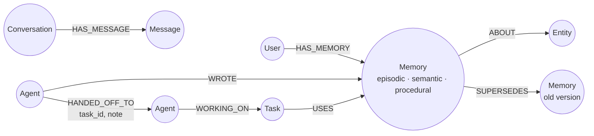

# RecallMesh — Shared Agent Memory & Coordination

**Graph Hacks 2026 · Track 2: Agent Memory and Coordination**
*Powered by FalkorDB*

> Agents are only as good as the context they work with. RecallMesh gives a team of
> agents **one shared, persistent memory that lives in a FalkorDB graph** — so what
> one agent learns in one session, every other agent can recall, build on, and hand
> off in the next session. Nobody re-asks the user. Nothing lives in a prompt.

---

## The problem

Most multi-agent demos share a fatal flaw: each agent's "memory" is a chat transcript
or a vector blob owned by that one agent. Switch agents, restart a session, or scale
to a second worker, and the context is gone — or worse, stale, duplicated and
contradictory. Users end up repeating themselves, and agents act on partial facts:
a planner that never heard about the user's peanut allergy will happily plan lunch.

RecallMesh solves this by making memory a **graph, shared by construction**:

- Memories hang off the **User**, not the agent — any agent traverses to all of them.
- Facts are connected to the **entities** they are about, so recall is a traversal
  ("everything connected to Atlas, Priya and peanuts"), not a similarity guess.
- Work moves between agents as **graph edges with context attached**, and shared
  tasks are claimed with a **conditional Cypher write**, so 20 racing agents
  produce exactly one winner.

## Who it's for

Teams building multi-agent products (support, ops, research, personal assistants),
and any agent system that must survive restarts, agent swaps and concurrent workers
while keeping one consistent, auditable picture of the user.

---

## What it does — mapped to the Track 2 brief

| Track 2 focus | How RecallMesh implements it |
|---|---|
| **Episodic memory** | Every conversation turn and task completion becomes an `(:Memory {kind:'episodic'})` node with session + timestamp. |
| **Semantic memory** | Facts extracted from conversation (preferences, allergies, deadlines, ownership) as `kind:'semantic'` nodes linked to `(:Entity)` nodes. |
| **Procedural memory** | How-things-are-done facts (standup time, workflows) as `kind:'procedural'` nodes, recalled like any other memory. |
| **Memory updates over time** | Re-writing a semantic fact **supersedes** the old node (`-[:SUPERSEDES]->`) instead of duplicating it; recall only returns `status:'active'`, and ranking decays with age. |
| **Persistent conversation history** | `(:Conversation)-[:HAS_MESSAGE]->(:Message)` plus one episode node per turn. History survives restarts because it lives in FalkorDB. |
| **Shared state & handoffs** | `(:Agent)-[:HANDED_OFF_TO {task_id, note}]->(:Agent)` with the relevant memories attached to the task via `(:Task)-[:USES]->(:Memory)`. The receiving agent reads context from the graph — the user repeats nothing. |
| **High-concurrency reads/writes** | Connection-pooled FalkorDB client; `MERGE` upserts; task claiming is a single conditional write (`WHERE status='OPEN'`) — verified by `scripts/concurrency_test.py`: 60 parallel writes + 60 reads, and a 20-agent claim race with exactly 1 winner and 19 clean `409`s. |
| **Separate memory per user/tenant** | **One FalkorDB graph per tenant** (`recallmesh_<tenant>`). Isolation is structural — a query physically cannot traverse into another tenant's graph — plus one `(:User)` subgraph per user inside it. |

## The three agents

| Agent | Role |
|---|---|
| **Researcher** | Listens to the user, stores the conversation + episode, extracts semantic/procedural facts into the graph. |
| **Planner** | In a *later session*, recalls relevant memory by traversal (and always safety-checks health/allergy memory), then creates shared tasks from what it recalled. |
| **Executor** | Claims tasks atomically, does the work, writes the result back as a new episode every other agent can see. |

Agents never call each other and keep **no private state**. Delete an agent,
start a fresh one — it has full context, because context is the graph.

## The 60-second demo story

1. **Session 1 (Monday, Researcher):** *"I prefer concise updates and our standup is
   at 9:30 am. I am allergic to peanuts. Project Atlas launches on Nov 20.
   Priya owns design for Atlas."* → 5 memories written (semantic + procedural + episode).
2. **Session 2 (Thursday, Planner — never heard Session 1):** "Plan the Atlas launch
   day" → traversal returns the deadline, Priya's ownership **and the peanut allergy**;
   the Planner creates tasks and flags the allergy as a safety check.
3. **Handoff:** Planner → Executor as a graph edge, memories attached.
4. **Session 3 (Executor):** claims the task (atomically), completes it, writes the
   result back. The Researcher can now recall the Executor's work. Full circle.

Run it with one click in the UI (`▶ Run the 3-session demo`) or `POST /api/demo/run`.

---

## Graph data model



**Nodes:** `User`, `Agent`, `Memory {id, kind, title, content, fact_type, confidence, status, version, session_id, created_at}`, `Entity {name}`, `Conversation`, `Message`, `Task {status: OPEN → IN_PROGRESS → HANDED_OFF → DONE}`.

**Why a graph and not a vector store / a table?** Recall here is *relational*:
"what does the agent taking over this task need, given who handed it off, what the
task uses, and which entities those memories share?" That is a 2-hop traversal with
ranking — `score = confidence × recency_decay + 0.5·entity_matches + 0.1·shared-entity neighbours` —
and it is exactly the query in [`queries.cypher`](queries.cypher) §3. Remove FalkorDB
and there is no memory, no recall, no handoff, no task board: the graph is the product.

## Cypher

All production queries live in [`queries.cypher`](queries.cypher), including:

- memory write + entity linking (§1), fact superseding (§2)
- ranked recall traversal (§3), handoff + "what was handed to me" (§4)
- atomic task claim (§5), conversation history (§6), procedural recall (§7)
- graph algorithms: `shortestPath` audit of how work travelled between agents,
  entity-hub degree ranking (§8), tenant isolation (§9)

---

## Quick start

### Option A — Docker (recommended, real FalkorDB)

```bash
git clone https://github.com/mvarunsptspt/recallmesh.git
cd recallmesh
docker compose up --build
# App:            http://localhost:8000
# FalkorDB Browser: http://localhost:3000   (run the queries from queries.cypher here)
```

Click **▶ Run the 3-session demo**, then explore the graph, task board and timeline.

### Option B — FalkorDB Cloud / your own FalkorDB

```bash
cp .env.example .env   # set FALKORDB_HOST / PORT / USERNAME / PASSWORD
pip install -r requirements.txt
uvicorn app.main:app --port 8000
```

### Option C — Offline preview (no Docker)

```bash
STORAGE_BACKEND=memory uvicorn app.main:app --port 8000
```
Preview mode mirrors the same node/edge model in memory so the UI and tests run
anywhere. It is a development convenience only — **the submitted product runs on
FalkorDB**, which is selected by default, and the UI badge always shows which
backend is live.

### Verify it works

```bash
python tests/test_memory.py                  # extraction, cross-session recall,
                                             # tenant isolation, superseding, claim race
python scripts/seed_demo.py                  # runs the 3-session story via the API
python scripts/concurrency_test.py           # 60W/60R in parallel + 20-agent claim race
```

## API (summary)

| Endpoint | What it does |
|---|---|
| `POST /api/messages` | Conversation turn → history + episode + extracted facts |
| `POST /api/remember` | Write a memory of any kind directly |
| `GET /api/recall?q=&user_id=&agent_id=` | Ranked graph-traversal recall |
| `POST /api/tasks` · `GET /api/tasks` | Shared task board |
| `POST /api/tasks/{id}/claim` | Atomic claim (`409` if already taken) |
| `POST /api/tasks/{id}/complete` | Complete + write result back as an episode |
| `POST /api/handoffs` · `GET /api/handoffs` | Agent→agent handoffs with context |
| `GET /api/graph` · `GET /api/timeline` · `GET /api/stats` | Graph snapshot, memory timeline, counts |
| `POST /api/demo/run` | The full 3-session story in one call |
| All endpoints take `?tenant=` / `"tenant"` | Tenant = separate FalkorDB graph |

## Project structure

```
app/graph.py       Graph layer: FalkorDB store (Cypher) + offline preview store
app/agents.py      Researcher / Planner / Executor — coordinate only via the graph
app/extraction.py  Deterministic fact extraction (no LLM key needed for the demo)
app/main.py        FastAPI app + API + demo orchestration
static/            Dashboard: teach, recall, task board, handoffs, live graph viz
queries.cypher     Every Cypher query / algorithm the product depends on
scripts/           seed_demo.py · concurrency_test.py
tests/             test_memory.py
docker-compose.yml FalkorDB + app, one command
```

## Tech

Python · FastAPI · **FalkorDB (primary graph database — Docker / Cloud)** · Cypher ·
vanilla JS dashboard. Fact extraction is rule-based and deterministic so the demo
needs no API keys; `extract_facts()` is a drop-in point for an LLM extractor.

## AI disclosure (per hackathon rules)

An AI coding assistant was used to help scaffold and write parts of this project.
All architecture decisions — the graph model, the per-tenant graph isolation, the
supersede-don't-duplicate update model, the atomic-claim pattern and the recall
ranking — are documented above and in `queries.cypher`, and the author can explain
and modify every query and component. (Rule 12/13: participants must understand the
submitted code — start with the demo, `queries.cypher`, and `tests/test_memory.py`.)

## License

MIT
